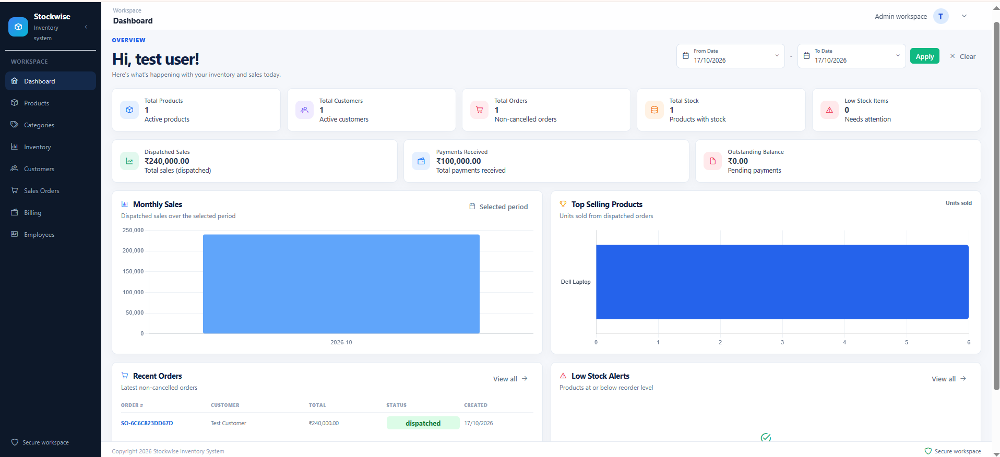
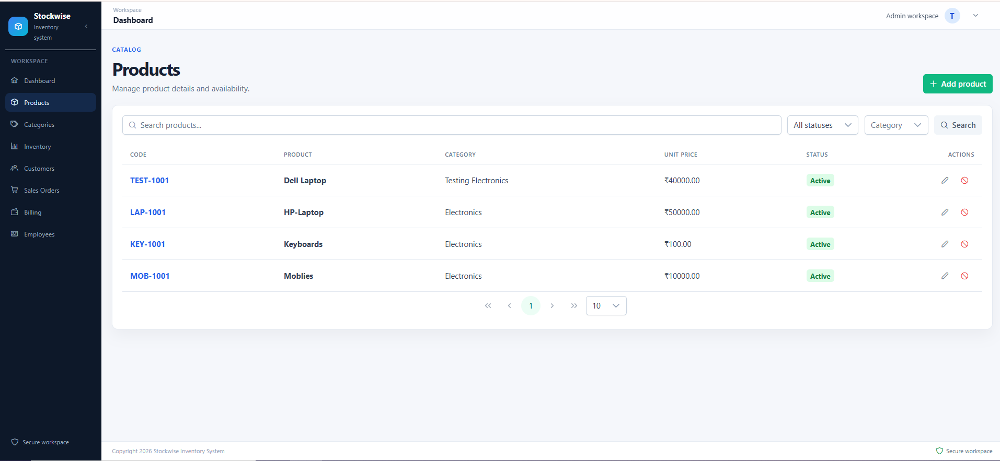
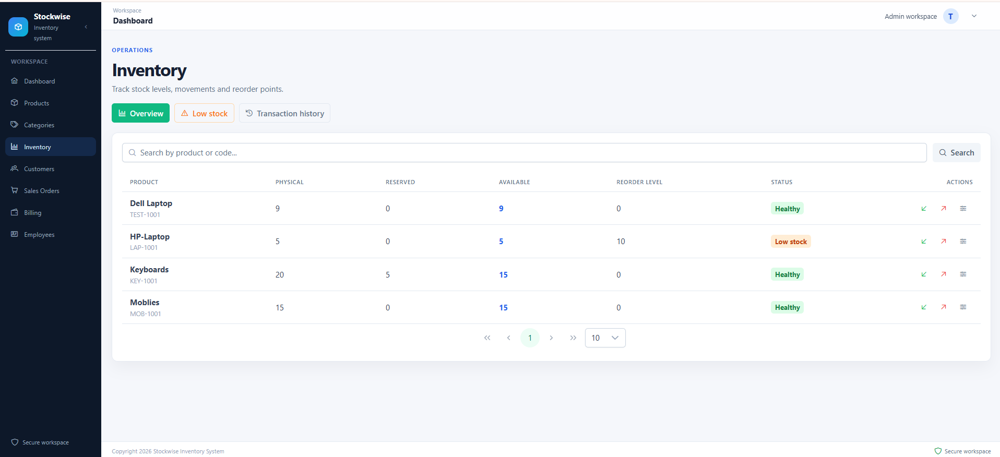
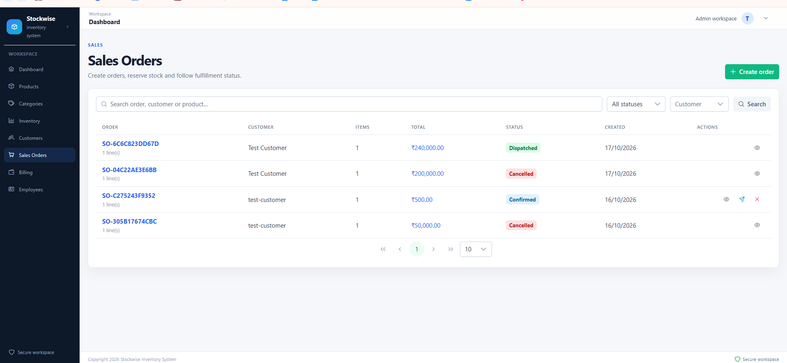
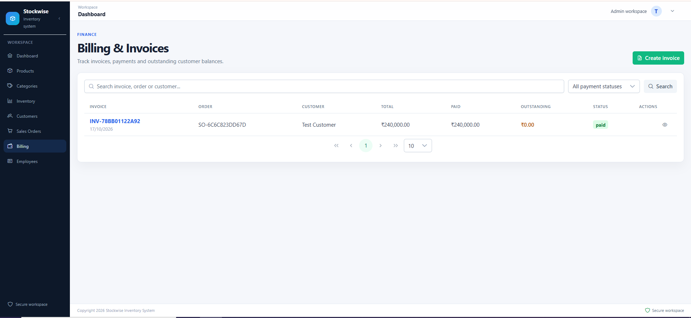

# Stockwise Inventory Management System

Stockwise is a full-stack inventory and sales management application for tracking products, stock, customers, sales orders, invoices, payments and operational analytics.

## Tech stack

- Backend: Django 6, Django REST Framework, PostgreSQL, SimpleJWT
- Frontend: Angular 22, TypeScript, PrimeNG Aura, PrimeIcons, Chart.js
- Authentication: JWT access and refresh tokens with refresh-token blacklisting on logout

## Implemented features

- JWT login, token refresh, logout and authenticated profile access
- Role-aware access for four roles:
  - **Admin** — full management access, including employees
  - **Inventory Manager** — products, categories and inventory management
  - **Sales Executive** — customers and sales order management
  - **Accountant** — billing and payment management
- Products and categories with search, filtering, pagination and soft deactivation
- Product codes, categories, prices and reorder levels
- Inventory stock overview, stock IN/OUT movements, reservations, transaction history and low-stock reporting
- Customer management with search, filters, pagination and soft deactivation/reactivation
- Sales orders with customer/product lines, unique order numbers and status workflow
- Billing with dispatched-order invoices, immutable invoice item snapshots, payment history and partial/full payment tracking
- Dashboard analytics for summary KPIs, dispatched sales, received payments, outstanding balances, monthly sales, top products, recent orders and low-stock products
- Responsive Angular workspace with sidebar navigation, role-aware actions, PrimeNG dialogs, validation, notifications and confirmation prompts
- Consistent `DD/MM/YYYY` date display in the frontend while API dates remain ISO formatted

## Business workflow

1. Create active products, categories and customers.
2. Record stock through Stock IN transactions.
3. Create a pending sales order. Pending orders do not reserve stock.
4. Confirm the order to reserve available stock.
5. Dispatch the order to deduct physical stock and release the reservation.
6. Create one invoice for a dispatched order.
7. Record one or more payments until the invoice is fully paid. Overpayments are rejected.
8. Cancel a confirmed order to release its reservation. Finalized order data cannot be changed.

Stock changes use database transactions and row locking to protect physical, reserved and available quantities during concurrent operations.

## Local setup

### Prerequisites

- Python 3.12+ with a virtual environment
- PostgreSQL 14+
- Node.js and npm compatible with Angular 22

### 1. Configure PostgreSQL

Create a PostgreSQL database and user, then update the values in `backend/.env`.

### 2. Configure and run Django

From the repository root:

```bash
python -m venv venv

# Windows PowerShell
venv\Scripts\Activate.ps1

# macOS/Linux
# source venv/bin/activate

pip install -r backend/requirements.txt
copy backend\.env.example backend\.env   # Windows
# cp backend/.env.example backend/.env     # macOS/Linux
```

Set the PostgreSQL credentials and a development secret in `backend/.env`, then run:

```bash
cd backend
python manage.py migrate
python manage.py runserver
```

The API is available at `http://127.0.0.1:8000/api/`.

### 3. Configure and run Angular

In a second terminal:

```bash
cd frontend
npm install
npm start
```

Open `http://localhost:4200/`. The development API URL is configured in `frontend/src/environments/environment.development.ts`; production uses `/api`.

## Docker deployment

The Docker stack is intended for a live-like deployment on the `stage` branch. It runs Angular behind Nginx, Django with Gunicorn, and PostgreSQL 16 with named persistent volumes.

### Configure the stack

Copy `docker.env.example` to `.env.docker` and replace the secret placeholders:

```bash
copy docker.env.example .env.docker   # Windows PowerShell
# cp docker.env.example .env.docker   # macOS/Linux
```

Set `DJANGO_ALLOWED_HOSTS` to the deployment hostname and use a long random value for both `DJANGO_SECRET_KEY` and `POSTGRES_PASSWORD`. `.env.docker` is ignored by Git.

The example stack serves HTTP on the configured frontend port, so it keeps `SECURE_SSL_REDIRECT=False`. For a live HTTPS deployment, terminate TLS at the external proxy/load balancer, set `SECURE_SSL_REDIRECT=True`, and update `DJANGO_ALLOWED_HOSTS` and `CSRF_TRUSTED_ORIGINS` for the real HTTPS origin.

### Build and start

```bash
docker compose --env-file .env.docker up --build -d
```

Open the application at `http://localhost:8080` by default, or use the port configured by `FRONTEND_PORT`.

The backend container runs migrations and `collectstatic` before starting Gunicorn. PostgreSQL data is stored in the `postgres_data` named volume; the existing local PostgreSQL installation and local development database are not modified.

### Check status and logs

```bash
docker compose --env-file .env.docker ps
docker compose --env-file .env.docker logs -f backend
docker compose --env-file .env.docker logs -f frontend
docker compose --env-file .env.docker logs -f db
```

### Stop the stack

```bash
docker compose --env-file .env.docker down
```

Do not use `docker compose down -v` unless the Docker PostgreSQL volume is intentionally being removed. The Docker database is separate from any PostgreSQL data used by the Windows local workflow.

## Environment variables

Use [`backend/.env.example`](backend/.env.example) as the template. Important values include:

```env
DJANGO_DEBUG=True
DJANGO_SECRET_KEY=replace-with-a-long-random-secret
DJANGO_ALLOWED_HOSTS=localhost,127.0.0.1
CORS_ALLOWED_ORIGINS=http://localhost:4200
DB_NAME=inventory_db
DB_USER=postgres
DB_PASSWORD=replace-with-local-password
DB_HOST=localhost
DB_PORT=5432
```

Never commit `backend/.env` or other files containing real credentials.

## API overview

All application endpoints require a valid JWT unless noted otherwise.

| Area | Endpoints |
| --- | --- |
| Auth | `POST /api/auth/login/`, `POST /api/auth/refresh/`, `POST /api/auth/logout/`, `GET /api/auth/profile/` |
| Products | `/api/products/`, `/api/products/categories/` |
| Inventory | `/api/inventory/stock/`, `/api/inventory/stock/in/`, `/api/inventory/stock/out/`, `/api/inventory/transactions/`, `/api/inventory/low-stock/` |
| Customers | `/api/customers/` |
| Sales orders | `/api/orders/`, plus `/confirm/`, `/dispatch/` and `/cancel/` actions |
| Billing | `/api/billing/invoices/`, `/api/billing/invoices/{id}/payments/` |
| Analytics | `/api/analytics/dashboard/`, `/sales/`, `/monthly-sales/`, `/top-products/`, `/recent-orders/`, `/low-stock/` |

List endpoints support the relevant search, filter, ordering and pagination parameters implemented by each module. Analytics endpoints accept `start_date` and `end_date` in `YYYY-MM-DD` format.

## Tests and useful commands

Run the backend test suite from the repository root:

```bash
python backend/manage.py test
```

Or from the backend directory:

```bash
cd backend
python manage.py test
```

Run Angular checks from `frontend/`:

```bash
npm run build
npm test
```

For a development build with source maps:

```bash
npm run build -- --configuration development
```

## Screenshots

Add real screenshots captured from the running application to `docs/screenshots/`:

### Dashboard



### Products



### Inventory



### Sales orders



### Billing and invoices



## Current status and limitations

The core catalog, inventory, customer, order, billing and analytics workflows are implemented with Angular screens and Django APIs. The project is suitable for local development and portfolio demonstration.

Before production deployment, complete environment-specific PostgreSQL provisioning, secret management, HTTPS/domain configuration, production CORS and allowed-host settings, email/observability setup, CI/CD, backups and deployment infrastructure. The repository currently has no dedicated end-to-end test suite or hosted deployment configuration.
